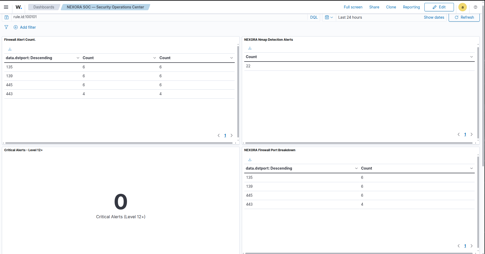
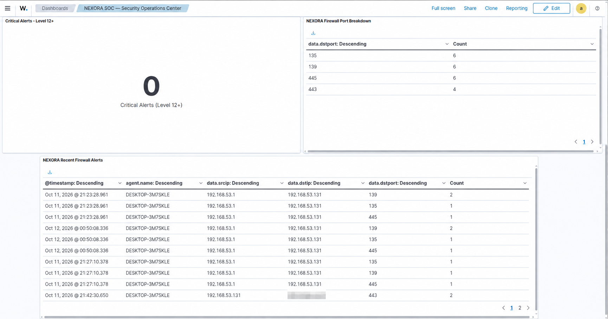

# Wazuh SOC Home Lab: Detecting Nmap Scans via Windows Firewall Logs

A home-lab SOC project that collects Windows Firewall logs with **Wazuh**, detects blocked TCP connection attempts using a **custom detection rule**, and documents the investigation workflow end to end.

> **Scope:** This repo documents one tested detection slice (firewall DROP → Wazuh alert). It does not claim endpoint compromise, production-scale coverage, or automated response.

## Overview

| Item | Value |
|---|---|
| SIEM | Wazuh 4.14.8 (Manager, Indexer, Dashboard) |
| Manager host | Ubuntu 24.04 (`D3F4ULT`) |
| Monitored endpoint | Windows 10 VM (`DESKTOP-3M7SKLE`, 192.168.53.131), agent ID 001 |
| Scan source | 192.168.53.1 (authorized lab scan) |
| Log source | `C:\Windows\System32\LogFiles\Firewall\pfirewall.log` |
| Custom rule | `100101`, level 8, groups `firewall_drop`, `nmap_detection` |

## Architecture

```
Scan source (192.168.53.1)
        │  TCP connection attempts (nmap -Pn -sT --top-ports 100)
        ▼
Windows 10 VM (192.168.53.131)  ── Windows Firewall writes pfirewall.log
        │  Wazuh agent forwards events
        ▼
Ubuntu host (D3F4ULT)
   ├─ Wazuh Manager: decoder "windows-firewall" + custom rule 100101
   ├─ Wazuh Indexer
   └─ Wazuh Dashboard: SOC Lab dashboard
```

## Detection Logic

Rule stored in `/var/ossec/etc/rules/local_rules.xml`:

```xml
<rule id="100101" level="8">
  <decoded_as>windows-firewall</decoded_as>
  <field name="action">DROP</field>
  <field name="protocol">TCP</field>
  <description>Windows Firewall blocked a TCP connection; investigate for possible network scanning.</description>
  <group>firewall_drop,nmap_detection,</group>
</rule>
```

Flow: firewall logs DROP → agent forwards → manager decodes fields (action, protocol, src/dst IP, dst port) → rule matches DROP + TCP → alert written to `alerts.json` and shown in the dashboard.

**Detection scope:** The rule matches Windows Firewall TCP `DROP` events. During the authorized Nmap lab test it generated six matching alerts in the summarized output, involving destination ports 135, 139 and 445. These events are consistent with blocked connection attempts, but the rule alone does not identify Nmap or confirm malicious activity.

**MITRE ATT&CK context (possible, not confirmed):** repeated blocked connections across many ports can relate to T1046 (Network Service Discovery). A single TCP `DROP` event does not confirm that technique; it needs correlation (many ports, one source, short time window).

**Validation status:** Tested in a local lab. False-positive testing and broader scan-type validation remain future work.

## Prerequisites

1. **Wazuh** (manager, indexer, dashboard) installed on the Ubuntu host, and the Wazuh agent installed on the Windows VM and showing **Active**.
2. **Enable Windows Firewall dropped-connection logging** on the Windows VM (admin PowerShell / cmd):
   ```
   netsh advfirewall set allprofiles logging droppedconnections enable
   netsh advfirewall set allprofiles logging filename "%systemroot%\system32\LogFiles\Firewall\pfirewall.log"
   ```
3. **Tell the agent to read the log.** Add to the agent's `ossec.conf` (`C:\Program Files (x86)\ossec-agent\ossec.conf`), then restart the agent service:
   ```xml
   <localfile>
     <location>C:\Windows\System32\LogFiles\Firewall\pfirewall.log</location>
     <log_format>syslog</log_format>
   </localfile>
   ```
4. **Add the custom rule** to `/var/ossec/etc/rules/local_rules.xml` on the manager, then validate and restart:
   ```bash
   sudo /var/ossec/bin/wazuh-analysisd -t
   sudo systemctl restart wazuh-manager
   ```

## Reproduce the Test

> Only scan systems you own or are explicitly authorized to test.

1. Confirm services:
   ```bash
   for s in wazuh-manager wazuh-indexer wazuh-dashboard; do echo "== $s =="; systemctl is-active "$s"; done
   ```
2. Run the scan from the scan-source machine:
   ```bash
   nmap -Pn -sT --top-ports 100 192.168.53.131
   ```
3. Find the alerts on the manager:
   ```bash
   sudo grep -F '"id":"100101"' /var/ossec/logs/alerts/alerts.json | tail -n 5
   ```
4. Validate rules after any change (before restarting the manager):
   ```bash
   sudo /var/ossec/bin/wazuh-analysisd -t
   ```

## Results

| Field | Observed |
|---|---|
| Timestamp | 2026-10-12 00:50:08 IST (+0530) |
| Matching events | 6 |
| Rule / level | 100101 / 8 |
| Agent | DESKTOP-3M7SKLE (001) |
| Source → Destination | 192.168.53.1 → 192.168.53.131 |
| Action / protocol | DROP / TCP |
| Destination ports | 135, 139, 445 |

Nmap result: host up, 99 filtered ports, 5357/tcp open (wsdapi).

Ports 135/139/445 are commonly associated with RPC, NetBIOS Session Service and SMB, which is why scans touching them are worth flagging.

## Investigation Notes (Analyst View)

- Confirm the source host identity and that the scan was authorized.
- Correlate Nmap output timestamps with firewall log entries.
- Check whether those services should be reachable under the lab's network policy.
- Disposition for this test: **authorized lab scan / blocked connection attempts**.
- Blocked attempts alone are **not** evidence of compromise.

The dashboard's Critical Alerts panel filters level 12+, so a level 8 alert does not appear there. This is expected.

## Troubleshooting

- DROP events appeared in `archives.json` first; custom rule alerts later appeared in `alerts.json`.
- If alerts are missing: check agent status, `pfirewall.log` logging enabled, manager status, rule syntax, and the dashboard time range.

## Dashboard Screenshots

Custom Wazuh dashboard filtered on `rule.id:100101` (last 24 hours):





What the dashboard shows:

- **22 alerts** from rule 100101 in the last 24 hours.
- **Ports 135, 139, 445:** 6 alerts each, all from the scan source 192.168.53.1 to the Windows VM (192.168.53.131), across several scan runs.
- **Port 443:** 4 alerts, but these are *outbound* connections from the VM (192.168.53.131) to a public IP. This is not scan traffic (see Limitations).
- **Critical Alerts (Level 12+): 0**, expected, since rule 100101 is level 8.

## Limitations / Future Work

- **False positive found:** the rule matches any `DROP` + `TCP` event regardless of direction, so outbound blocked connections from the VM (port 443 to a public IP) also trigger it. Fix: add a source-IP / direction condition, or require the destination to be the monitored host, and tune the rule.
- Only TCP DROP detection was tested; no broader false-positive testing yet.
- No UDP, SYN-scan or slow-scan variants tested.
- Possible next steps: threshold/frequency-based rule (many ports from one source in N seconds), MITRE ATT&CK mapping (T1046 Network Service Discovery), active response, alert tuning.

## Author

Gaurav Singh Chauhan — [GitHub](https://github.com/gs-chauhan07) · [LinkedIn](https://linkedin.com/in/gaurav-singh-chauhan-029142280)